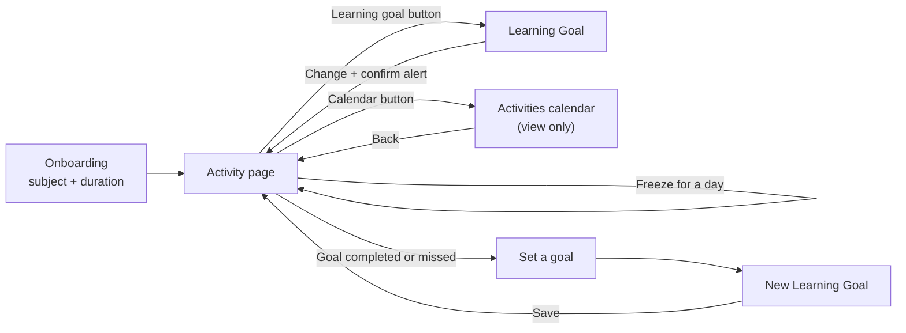

# Learning App

A small iOS app that helps you build a daily learning habit. Pick something to learn, choose how long you want to stick with it, and log every day you study. Keep your streak alive, and protect it with a limited number of freezes when life gets in the way.

Built with SwiftUI and SwiftData, following the MVVM pattern, with a Liquid Glass interface in a dark theme.

## Table of Contents

- [About](#about)
- [Features](#features)
- [App Workflow](#app-workflow)
- [Rules](#rules)
- [Screens](#screens)
- [Architecture](#architecture)
- [Tech Stack](#tech-stack)
- [Getting Started](#getting-started)
- [Git Workflow](#git-workflow)
- [Status](#status)

## About

Learning App turns "I want to learn Swift" into a goal with a clear finish line. You set a subject and a duration (a week, a month or a year), then come back each day and log that you learned. Every logged day moves you closer to completing the goal. If you cannot study, you can spend a freeze to keep your streak. If you stay away for too long, the goal is missed and you can start a new one.

The project started from a set of design tasks (workflow, screens and rules) and implements them screen by screen, each one developed on its own branch and merged through a pull request.

## Features

- **Goal setting**: choose what you want to learn and a duration of a week, a month or a year.
- **Daily logging**: log the current day as learned, or freeze it.
- **Streak tracking**: learned and freezed days are counted and shown on the activity page.
- **Week strip**: the current week at a glance, with learned days in orange and freezed days in blue.
- **Freezes**: a limited number of freezes per goal, depending on its duration.
- **Goal outcomes**: a celebration when the goal is completed, and a clear message when it is missed.
- **Goal management**: update the current goal, or start a new one once the previous goal is over.
- **Activity calendar**: a view-only calendar of every learned and freezed day, month by month, across all of your goals.
- **Persistence**: everything is stored on the device with SwiftData.
- **Dark theme and Liquid Glass**: the app always uses the dark appearance, and its buttons use the Liquid Glass material.

## App Workflow

The app is organised around five tasks:

| Task | Goal | Screens |
| --- | --- | --- |
| 1 | Start learning | Onboarding, then the Activity page |
| 2 | Log a day as learned or freezed | Activity page |
| 3 | Set a new goal when the current one is completed or missed | Activity page, New Learning Goal |
| 4 | Change the learning goal | Activity page, Learning Goal, confirmation alert |
| 5 | Open the calendar to see all previous learned days | Activity page, Activities (calendar) |



### Task 1: Start learning

1. On first launch, Onboarding asks what you want to learn and for how long.
2. No duration is selected at first. **Start Learning** lights up only once you have typed a subject and picked a duration.
3. Starting creates your goal and opens the Activity page.

### Task 2: Log a day

1. The Activity page shows the date, the current week, your learned and freezed counts, and the two actions.
2. **Log as Learned** counts the day towards the goal. **Freeze for a day** keeps the streak without counting the day.
3. Once the day is logged, both buttons are disabled until midnight.

### Task 3: A new goal after completion or failure

1. When the goal is completed, the page shows "Well done! Ready for your next goal?". When it is missed, it shows "You didn't reach your goal this time. Want to set another goal?".
2. **Set a goal** opens **New Learning Goal**. Saving it starts a fresh goal with the counters back at zero.
3. The previous goal stays stored, so its days remain in the calendar.

### Task 4: Change the learning goal

1. The learning goal button in the header opens **Learning Goal**, prefilled with the current subject and duration.
2. Confirming with changes shows an alert: "If you update now, your streak will start over." with **Dismiss** and **Update**.
3. Confirming without changes simply goes back.

### Task 5: The calendar

1. The calendar button in the header opens **Activities**.
2. It is view only. It opens on the current month, with a year of months before and after, and goes back further if older days were logged.
3. Learned days are orange, freezed days are blue, and today is highlighted until it is logged.

## Rules

### Streak

- A streak breaks, and the goal is missed, when **more than 32 hours** pass without logging a day as learned and without using a freeze. The 32 hours are counted from the last time a day was logged, or from the moment the goal started if nothing has been logged yet.
- Updating the learning goal starts over from zero.

### Completing a goal

A goal is completed when the number of **learned** days reaches its duration. Freezes protect the streak but do not count towards completion, so using a freeze gives you more time rather than less.

| Duration | Learned days needed | Freezes available |
| --- | --- | --- |
| Week | 7 | 2 |
| Month | 30 | 8 |
| Year | 365 | 96 |

### Buttons

Both **Log as Learned** and **Freeze for a day** are disabled when:

- the current day has already been logged (either way),
- or, for the freeze button only, all freezes have been used.

The buttons are enabled again at 12 AM, even if the previous day was logged at 11 PM.

### Wording

When a count is exactly one, the word is singular: "1 day", not "1 days". Everything else is plural: "0 days", "2 days".

## Screens

| Screen | Purpose |
| --- | --- |
| Onboarding | First launch: choose a subject and a duration |
| Activity | Main page: week strip, counters, log and freeze actions, goal outcome |
| Learning Goal | Edit the current goal, with a confirmation alert |
| New Learning Goal | Set a new goal after the previous one is completed or missed |
| Activities | View-only calendar of all learned and freezed days |

## Architecture

The app follows **MVVM**:

- **Model**: the data and its rules, with no knowledge of the UI.
- **View**: SwiftUI views that only display state and forward user actions.
- **ViewModel**: `@Observable` classes that hold the logic and expose ready-to-display state to the views.

```
Learning App/
├── Models/
│   ├── GoalDuration.swift          Week / Month / Year, required days and freezes
│   ├── LearningGoal.swift          The goal, its logs, and completed / missed status
│   └── DayLog.swift                A logged day: learned or freezed
├── ViewModels/
│   ├── GoalFormViewModel.swift     Shared state of the subject and duration form
│   ├── ActivityViewModel.swift     Counters, week strip, buttons, goal status, midnight refresh
│   └── ActivityCalendarViewModel.swift   Builds the months shown in the calendar
├── Views/
│   ├── OnboardingView.swift
│   ├── ActivityView.swift
│   ├── UpdateGoalView.swift
│   ├── NewGoalView.swift
│   ├── ActivityCalendarView.swift
│   ├── RootView.swift              Onboarding until a goal exists, then Activity
│   └── Components/                 Week strip, day circle, stat card, glass buttons, form fields
└── MyApp.swift                     App entry point and SwiftData container
```

A few design notes:

- `LearningGoal.status(at:)` is a pure function, so the completed and missed rules live in one place and are easy to test.
- A day holds a single log. The 32-hour rule uses the exact time of logging (`DayLog.loggedAt`), not just the date.
- The Activity page re-checks the clock at midnight and at the streak deadline, so it never shows a stale state.
- When a goal is updated or replaced, a new goal is created and the old one is kept, so the calendar can show the full history.

## Tech Stack

- **Language**: Swift
- **UI**: SwiftUI, with Liquid Glass buttons
- **Persistence**: SwiftData
- **Concurrency**: Swift concurrency (`async` / `await`), no Combine
- **Architecture**: MVVM with the Observation framework
- **Minimum deployment target**: iOS 27.0

## Getting Started

### Requirements

- A Mac with a version of Xcode that includes the iOS 27 SDK
- An iOS 27 simulator or device

### Run the app

1. Clone the repository:

   ```bash
   git clone https://github.com/Aseel1166/Learning-App.git
   cd Learning-App
   ```

2. Open `Learning App.xcodeproj` in Xcode.
3. Select an iPhone simulator.
4. Press **Run** (⌘R).

The app stores its data on the device. To start over from the Onboarding screen, delete the app from the simulator and run it again.

## Git Workflow

Work is split into small branches, one per page or feature:

1. Create a branch from `main` with a descriptive name (for example `feature/activity-page`).
2. Commit with a clear message that explains what was added.
3. Push the branch and open a pull request into `main`.
4. After the review, merge the pull request, update `main` and branch off again for the next piece of work.

| Branch | Work |
| --- | --- |
| `feature/onboarding` | Onboarding page (Task 1) |
| `feature/activity-page` | Activity page and day logging (Task 2) |
| `feature/goal-completion` | Completed and missed goal states, new goal page (Task 3) |
| `feature/update-goal` | Update learning goal page with confirmation alert (Task 4) |
| `feature/calendar` | Activities calendar, Liquid Glass buttons (Task 5) |

## Status

All five tasks are implemented and merged into `main`.

Ideas for later:

- Unit tests for the goal rules (`LearningGoal.status(at:)`) and the calendar view model
- iPad layout and Dynamic Type review
- Localization
